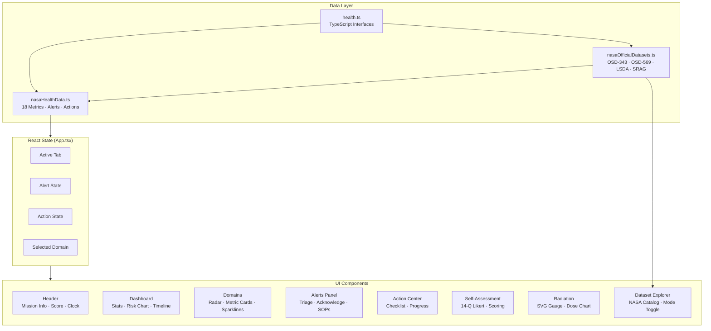

<div align="center">

# 🚀 AstroHealth Monitor

### Astronaut Health & Telemetry for Deep Space

**An integrated physiological, behavioral, and radiation monitoring platform grounded in published NASA Human Research Program (HRP) standards, ISS medical protocols, and NCRP Report 132 occupational dose limits.**

[](https://react.dev)
[](https://www.typescriptlang.org)
[](https://vitejs.dev)
[](https://tailwindcss.com)
[](https://opensource.org/licenses/MIT)

**2026 NASA Space Apps Challenge** · Built by **Ashique P Jo** · S5 CSE (Artificial Intelligence), SJCET Palai

</div>

---

## 📋 Table of Contents

- [The Problem](#-the-problem)
- [Our Solution](#-our-solution)
- [NASA Datasets Used](#-nasa-datasets-used)
- [Features & Modules](#-features--modules)
- [Tech Stack](#-tech-stack)
- [Project Structure](#-project-structure)
- [Getting Started](#-getting-started)
- [Architecture](#-architecture)
- [Screenshots](#-screenshots)
- [Scientific Grounding](#-scientific-grounding)
- [Future Roadmap](#-future-roadmap)
- [AI & Tool Disclosure](#-ai--tool-disclosure)
- [License](#-license)

---

## 🔴 The Problem

Long-duration spaceflight triggers **simultaneous multi-system deconditioning** that current siloed mission telemetry tools fail to address holistically:

| Hazard | Impact | Source |
|---|---|---|
| **Cardiovascular Deconditioning** | Cephalic fluid shifts reduce plasma volume 8–12%; VO₂ max drops ~17% at 6 months | Perhonen et al., 2001; Moore et al., 2010 |
| **Bone & Muscle Atrophy** | 1–1.5%/month bone mineral density (BMD) loss in lumbar spine & femoral neck; ~25% lower-limb strength decline | Sibonga et al., 2007; Lang et al., 2004 |
| **Immune Suppression** | Elevated cortisol suppresses NK cell activity (~40%); latent viral reactivation (EBV, VZV, CMV) | Crucian et al., 2008/2013 |
| **Behavioral Health** | 16 sunrises/day disrupt circadian rhythm; third-quarter mood dips; isolation-driven cognitive fatigue | Barger et al., 2014; Stuster, 2010 |
| **Radiation Exposure** | ~1.28 mGy/day ISS average from GCR + SPE; cumulative cancer risk tracks against NCRP career limits | NCRP Report 132; NASA SRAG |

> **Core Gap:** Biomarkers, DXA scans, radiation dosimeters, and self-reports sit in disconnected tools — delaying preventive intervention. Deep-space crews need **unified, proactive health visibility** — not fragmented spreadsheets.

---

## 💡 Our Solution

**AstroHealth Monitor** provides a single unified interface connecting physiological telemetry directly to daily crew countermeasures across **5 health domains** and **18 monitored indicators**.

### Simulated Mission Benchmark

| Parameter | Value |
|---|---|
| **Mission** | Artemis Gateway-1 (Day 142 / 240) |
| **Overall Health Index** | 71 / 100 (down from 95 at launch) |
| **Monitored Indicators** | 18 total (11 Nominal · 7 Warning) |
| **Flagged Domains** | Cardiovascular, Bone/Muscle, Immune, Behavioral |
| **Radiation Used** | 182.5 mGy / 1,000 mGy career limit (18.3%) |

---

## 🛰️ NASA Datasets Used

AstroHealth Monitor is grounded in **official NASA open-science datasets and repositories**. All physiological baselines, decline rates, and threshold values are benchmarked against real astronaut flight data:

### Primary Dataset

| Field | Details |
|---|---|
| **Accession** | **OSD-343** (GeneLab ID: GLDS-343) |
| **Title** | NASA Twins Study: Longitudinal Multi-Omics and Physiological Analysis of Astronaut Spaceflight Impact |
| **Repository** | [NASA Open Science Data Repository (OSDR)](https://osdr.nasa.gov/bio/repo/data/studies/OSD-343) |
| **DOI** | [10.1126/science.aau8650](https://doi.org/10.1126/science.aau8650) |
| **Mission** | ISS Expeditions 43–46 (Scott Kelly, 340-day mission) |
| **Data Used** | HR & BP trends, VO₂ max decline, femoral/lumbar BMD loss rates, NK cell suppression, cortisol elevation, cognitive performance, cumulative radiation dose |
| **Citation** | Garrett-Bakelman, F.E. et al. "The NASA Twins Study: A multidimensional analysis of a year-long human spaceflight." *Science* 364, eaau8650 (2019) |

### Supporting Datasets & Repositories

| Accession | Repository | Title | Link | What It Provides |
|---|---|---|---|---|
| **OSD-569** | NASA OSDR | Spaceflight Hematology: Complete Blood Count & Immune Dynamics | [osdr.nasa.gov/…/OSD-569](https://osdr.nasa.gov/bio/repo/data/studies/OSD-569) | WBC differentials, neutrophil/lymphocyte ratios, stress leukocytosis benchmarks |
| **NASA-LSDA-HRP** | NASA LSDA | Life Sciences Data Archive: Human Research Program Clinical Evidence Base | [lsda.jsc.nasa.gov](https://lsda.jsc.nasa.gov/) | ARED bone loss rates (1.0–1.5%/mo), CEVIS VO₂ decline thresholds, circadian countermeasure protocols |
| **NASA-SRAG-ISS-RAD** | NASA Open Data | Space Radiation Analysis Group: ISS Radiation Environment Monitor | [data.nasa.gov](https://data.nasa.gov/) | Daily absorbed dose rates (~1.28 mGy/day), GCR vs SPE contribution splits, NCRP Report 132 career limits |

### How Real Data Is Integrated

The app includes a **Dataset Explorer** tab with a mode toggle:

- **🚀 Artemis Gateway-1 (Model)** — Simulated 240-day mission using calibrated HRP drift curves derived from the above datasets
- **✓ NASA OSDR OSD-343 (Real Data)** — Empirical 340-day flight measurements from Scott Kelly's year-in-space, with 8 longitudinal timepoints (L-60 through R+30)

Every metric card displays its `nasaRef` field linking back to the specific HRP Evidence Report, NCRP standard, or peer-reviewed study that defines its baseline, warning thresholds, and decline model.

---

## ✨ Features & Modules

### 1. 📊 Mission Overview Dashboard
- Unified Health Index (0–100) with real-time status
- Indicator summary: Nominal / Warning / Critical counts
- Domain Risk Score bar chart (Recharts)
- 142-day health trajectory area chart
- Quick-access domain cards with flagged metrics

### 2. 🫀 Health Domains (5-Axis System Health)
- **Cardiovascular** — HR, systolic/diastolic BP, VO₂ max, cardiac output (5 metrics)
- **Bone & Muscle** — Lumbar BMD, femoral neck BMD, lower-limb strength, spinal elongation (4 metrics)
- **Immune System** — WBC, NK cell activity, salivary cortisol, C-reactive protein (4 metrics)
- **Behavioral Health** — Sleep quality, cognitive performance, mood, team cohesion (4 metrics)
- **Radiation** — Cumulative absorbed dose with GCR/SPE split (1 metric)
- Interactive radar chart for system-wide health at a glance
- Individual metric cards with baseline comparison bars and longitudinal sparkline charts

### 3. 🚨 Clinical Alerts Panel
- Automated anomaly alerts showing % deviation from baseline
- Severity badges (Critical / Warning / Info)
- Acknowledgement workflow with timestamps
- Linked NASA HRP Standard Operating Procedures (SOPs) for each alert
- Recommended countermeasure actions

### 4. ✅ Daily Action Center
- Prioritized countermeasure checklist (High / Medium / Low)
- Protocols: ARED resistance training, CEVIS ergometer, light therapy, supplements, saliva collection
- Live progress bar tracking daily protocol completion
- Filter by: All / Pending / Done

### 5. 📝 Self-Assessment Questionnaire
- 14-question weekly Likert (1–5) check-in
- 6 categories: Sleep, Cognition, Mood, Physical, Immune, Social
- Category-by-category navigation with completion indicators
- Composite score with status-based recommendation (nominal / needs attention / concerning)
- Adapted from NASA HRP behavioral health protocols

### 6. ☢️ Radiation Monitor
- Circular SVG career-limit gauge (NCRP Report 132)
- Daily dose rate display (1.28 mGy/d ISS average)
- GCR vs Solar Particle Event split
- Remaining career dose budget
- Cumulative dose area chart over mission duration

### 7. 🛰️ NASA Dataset Explorer *(New)*
- Browse catalog of 4 integrated NASA open-science datasets
- Direct links to NASA OSDR, LSDA, and Open Data portals
- Toggle between simulated model and real empirical data modes
- Tabular view of empirical data records with mission-phase annotations
- DOI and PI citation display

---

## 🛠️ Tech Stack

| Layer | Technology | Purpose |
|---|---|---|
| **Framework** | React 18.3 | Component-based SPA with Hooks |
| **Language** | TypeScript 5.7 | Strict type safety across all data models |
| **Bundler** | Vite 6.0 | Sub-second HMR, optimized production builds |
| **Visualization** | Recharts 2.13 | Area, Bar, Line, Radar charts + custom SVG radial gauge |
| **Icons** | Lucide React 0.469 | Consistent icon system |
| **Styling** | Tailwind CSS 3.4 + custom glassmorphism | Warm amber-toned space UI with blur effects |
| **Typography** | Orbitron · Inter · JetBrains Mono | Display · Body · Monospace data |
| **Utilities** | clsx 2.1 | Conditional className composition |

---

## 📁 Project Structure

```
NASA-Space-Apps-Challenge/
├── index.html                         # Entry HTML
├── package.json                       # Dependencies & scripts
├── tsconfig.json                      # TypeScript configuration
├── vite.config.ts                     # Vite bundler configuration
├── tailwind.config.js                 # Tailwind CSS configuration
├── postcss.config.js                  # PostCSS with Tailwind plugin
├── Presentation/
│   └── Ashique_P_Jo.pptx             # Challenge presentation (6 slides)
├── dist/                              # Production build output
├── public/
│   └── favicon.svg                    # App favicon
└── src/
    ├── main.tsx                       # React DOM entry point
    ├── App.tsx                        # Root app — tab routing, state management
    ├── index.css                      # Global styles, glassmorphism, animations
    ├── components/
    │   ├── Header.tsx                 # Sticky header: crew info, mission progress, health score, clock
    │   ├── MetricCard.tsx             # Individual health metric: value, trend, range bar, sparkline
    │   ├── DomainOverview.tsx         # Radar chart + domain selector sidebar
    │   ├── AlertsPanel.tsx            # Clinical alerts with acknowledge workflow
    │   ├── ActionCenter.tsx           # Daily protocol checklist with priority filtering
    │   ├── SelfAssessmentForm.tsx     # 14-question Likert self-assessment
    │   ├── RadiationPanel.tsx         # SVG gauge + dose charts + GCR/SPE stats
    │   ├── DatasetExplorer.tsx        # NASA OSDR dataset browser & mode toggle
    │   ├── StatusBadge.tsx            # Reusable status indicator (nominal/warning/critical)
    │   └── Starfield.tsx              # Animated background star particles
    ├── data/
    │   ├── nasaHealthData.ts          # All 18 health metrics, alerts, actions, profiles
    │   └── nasaOfficialDatasets.ts    # Official NASA dataset catalog (OSD-343, OSD-569, LSDA, SRAG)
    └── types/
        └── health.ts                  # TypeScript interfaces for all domain models
```

---

## 🚀 Getting Started

### Prerequisites

- **Node.js** ≥ 18
- **npm** or **pnpm**

### Installation

```bash
# Clone the repository
git clone https://github.com/<your-username>/NASA-Space-Apps-Challenge.git
cd NASA-Space-Apps-Challenge

# Install dependencies
npm install

# Start development server
npm run dev
```

The app will be available at `http://localhost:5173`.

### Build for Production

```bash
npm run build
npm run preview    # Preview the production build locally
```

The optimized bundle is output to `dist/`.

---

## 🏗️ Architecture



### Data Flow

1. **NASA Dataset Layer** (`nasaOfficialDatasets.ts`) — Stores structured records from OSD-343 (Twins Study), OSD-569 (hematology), LSDA (HRP protocols), and SRAG (radiation dosimetry)
2. **Health Data Engine** (`nasaHealthData.ts`) — Generates 142-day physiological drift curves calibrated to the above datasets using `generateHistory()` with domain-specific decline functions
3. **React State** (`App.tsx`) — Manages tab navigation, alert acknowledgements, action completion, and domain selection via `useState` and `useCallback` hooks
4. **Visualization Layer** — Recharts renders longitudinal sparklines, bar charts, radar charts, and area charts; custom SVG renders the radiation career-limit gauge

---

## 🔬 Scientific Grounding

All metric baselines, warning thresholds, decline rates, and countermeasure protocols are derived from the following published sources:

### NASA Standards & Evidence Reports
- **NASA-STD-3001 Vol. 2** — Human Integration Design Handbook (physiological norms, CO₂ limits)
- **HRP-47060** — Evidence Report: Risk of Adverse Cardiovascular Events
- **HRP BHBR** — Bone Health and Bone Recovery Evidence Report
- **HRP Immunology Risk** — Viral Reactivation and Immune Dysregulation
- **HRP Behavioral Health Risk** — Sleep, Cognition, and Crew Cohesion
- **NCRP Report 132** — Radiation Protection Guidance for Activities in Low-Earth Orbit (1,000 mGy / 1 Sv career limit)

### Peer-Reviewed Publications

| Citation | Domain | Key Finding Used |
|---|---|---|
| Garrett-Bakelman et al., *Science* (2019) | Multi-system | NASA Twins Study — 340-day longitudinal flight data |
| Sibonga et al., *Bone* (2007) | Bone | 1–1.5%/month lumbar & femoral neck BMD decline |
| Lang et al., *JBMR* (2004) | Bone | Femoral neck as highest fracture-risk site |
| Moore et al., *J Physiol* (2010) | Cardiovascular | VO₂ max ~17% decline at 6 months |
| Perhonen et al., *J Physiol* (2001) | Cardiovascular | Plasma volume loss 8–12% in first week |
| Crucian et al., *J Interferon Cytokine Res* (2008, 2013) | Immune | NK cell function ~40% reduction; viral reactivation |
| Mehta et al., *Psychosom Med* (2000) | Immune | EBV reactivation under spaceflight stress |
| Barger et al., *Lancet Neurol* (2014) | Behavioral | ~75% ISS crew report sleep disturbances |
| Stuster, *NASA TM-2010-216130* (2010) | Behavioral | Third-quarter phenomenon; crew cohesion patterns |
| Kanas & Manzey (2008) | Behavioral | Space psychology and mission mood dynamics |
| Trappe et al., *J Physiol* (2004) | Musculoskeletal | ~25% lower-limb strength loss in 6 months |

---

## 🗺️ Future Roadmap

| Phase | Feature | Details |
|---|---|---|
| **v2.0** | Live Biosensor Streaming | WebSocket feeds from wearable ECG, SpO₂, and cabin CO₂/dosimeter via HL7 FHIR APIs |
| **v2.1** | Predictive ML Risk Models | Time-series forecasting on NASA LSDA records to predict 30-day bone/fatigue risk |
| **v2.2** | Multi-Crew Fleet View | Scale from single-astronaut to full 4–6 person crew health comparison |
| **v2.3** | Offline-First PWA | IndexedDB persistence + service workers for uninterrupted deep-space operation |
| **v3.0** | NASA OSDR Live API | Real-time queries against the OSDR REST/GraphQL API for on-demand dataset exploration |

---

## 🤖 AI & Tool Disclosure

In compliance with the **2026 NASA Space Apps Challenge** guidelines:

- **Human-Led Concept** — Problem framing, clinical domain selection, countermeasure workflow design, and NASA dataset curation were performed entirely by the creator
- **SI-Assisted Implementation** — Large Language Models (LLMs) assisted with React/TypeScript component scaffolding, Recharts configuration, synthetic drift curve math, and README generation
- **Open-Source Stack** — React (MIT), TypeScript (Apache-2.0), Vite (MIT), Tailwind CSS (MIT), Recharts (MIT), Lucide Icons (ISC), Google Fonts (OFL)
- **NASA Branding Compliance** — Original UI theme and iconography; zero restricted NASA logos, insignias, or mission patches used

---

## 📄 License

This project is open source under the [MIT License](LICENSE).

---

<div align="center">

**AstroHealth Monitor** · Proactive biomedical telemetry for safer long-duration human spaceflight

Built with ❤️ by **Ashique P Jo** · S5 CSE (Artificial Intelligence) · SJCET Palai

*2026 NASA Space Apps Challenge*

</div>
